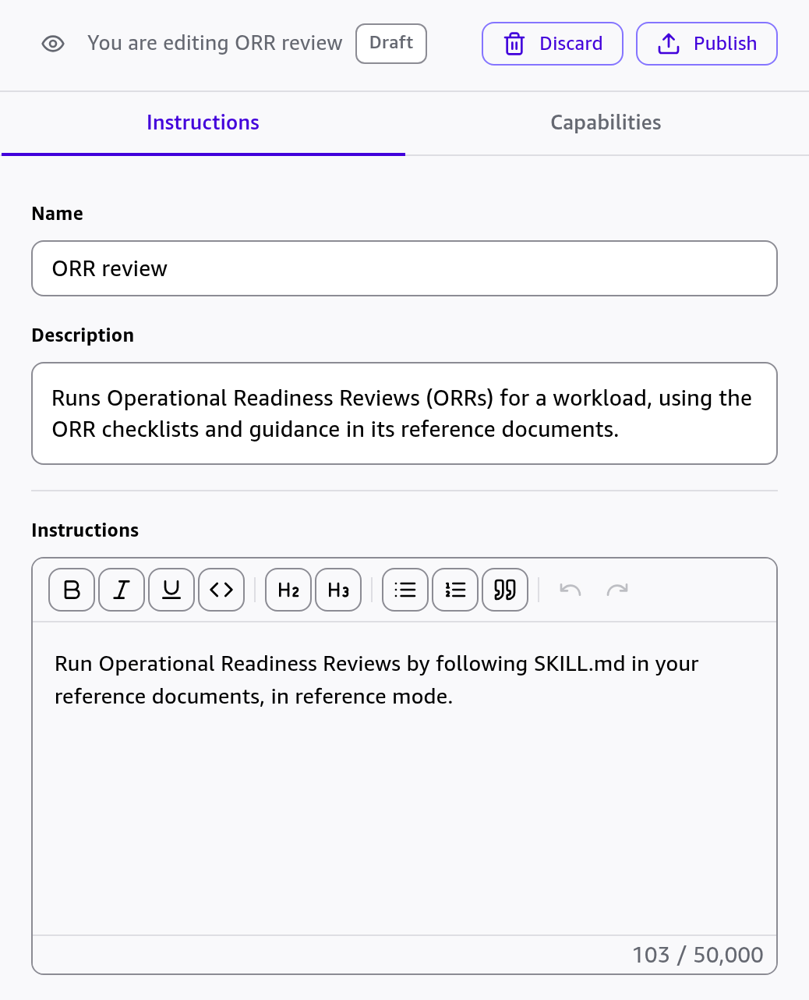

# orr-review: an agent skill for running an ORR

`orr-review` lets a coding agent or chat assistant run an Operational Readiness Review (ORR) with the lenses in this
repository, with or without the AWS Well-Architected Tool (WA Tool). It follows the open
[Agent Skills](https://agentskills.io/specification) format: a `SKILL.md` with instructions, a standard-library
Python script, and reference files.

The agent asks each question, shows the evidence to collect, records the team's answers, scores each answer with
the lens's own risk rules (the same rules the WA Tool applies to the imported lens), and writes a Markdown findings
report: risk counts per pillar, each High and Medium risk with the statements that are not in place and their
improvement plans, accepted risks with expiry status, and unanswered questions.

It keeps score in one of two ways:

- **Script mode**, for agents that can run Python (Claude Code, Kiro, Kiro Crew, Codex): `scripts/orr.py` reads the
  release lens JSON files, keeps the answers in a JSON file, scores them and writes the report.
- **Reference mode**, for agents that cannot (Amazon Quick, chat assistants): the agent reads the lens from the
  plain-text files bundled in `references/`, keeps the answers in a table and scores by hand from the risk lines.

| File | What it holds |
|---|---|
| `SKILL.md` | The instructions the agent follows |
| `scripts/orr.py` | Script mode: finds the lens files, shows questions, keeps the answers file, scores, writes the report |
| `references/lens-core.md`, `lens-event.md`, `lens-genai.md` | Reference mode: each question, its evidence lines, statements and risk lines |
| `references/plans-core.md`, `plans-event.md`, `plans-genai.md` | The improvement plan for each statement |
| `references/report-template.md` | The report format for reference mode |
| `references/facilitation.md` | Roles, time boxes, how to challenge answers, what the risk levels mean |

The `lens-*.md` and `plans-*.md` files are generated from the lens sources by `python3 -m tools.orrlens docs`, so
they always match the lens release in the same commit.

The skill reads the lens files and writes only the answers and the report you name. It needs no AWS credentials
and makes no network calls; the agent downloads the lens files only if you ask it to.

## Get the lens files

Put the release files in the folder where you run the review, and check them:

```bash
curl -sSLO https://github.com/awslabs/operational-readiness-review-custom-war-lens/releases/latest/download/orr-core.json
curl -sSLO https://github.com/awslabs/operational-readiness-review-custom-war-lens/releases/latest/download/SHA256SUMS
sha256sum --ignore-missing -c SHA256SUMS        # macOS: shasum -a 256 --ignore-missing -c SHA256SUMS
```

Add `orr-event.json` (planned peaks) and `orr-genai.json` (foundation models and AI agents) when they apply. In a
clone of this repository the files are already in `dist/`, and the script takes `--lens-dir dist`.

## Install

The skill is the folder `skills/orr-review/` of this repository. Each tool below loads a skill when your request
matches its description ("run an ORR for checkout-api"), or when you name it.

### With the skills CLI (Claude Code, Codex, Kiro CLI and others)

The [skills CLI](https://github.com/vercel-labs/skills) (Node.js) copies or links the folder into each agent's skills
directory:

```bash
npx skills add awslabs/operational-readiness-review-custom-war-lens --skill orr-review -a claude-code -a codex -a kiro-cli
```

Add `-g` to install it for your user instead of the current project.

### Claude Code

Copy the folder to `~/.claude/skills/orr-review/` (every project) or to `.claude/skills/orr-review/` in a
project. Ask for an ORR, or type `/orr-review`. See
[Extend Claude with skills](https://code.claude.com/docs/en/skills).

### Kiro (IDE and CLI)

Copy the folder to `~/.kiro/skills/orr-review/` (global) or to `.kiro/skills/orr-review/` in a workspace, then
start a new chat session. In the IDE you can also choose **Agent Steering & Skills**, **+**, **Import a skill**, and
paste `https://github.com/awslabs/operational-readiness-review-custom-war-lens/tree/main/skills/orr-review`. Ask
for an ORR, or type `/orr-review`. A custom agent loads skills only through `skill://` entries in its `resources`.
See [Agent Skills](https://kiro.dev/docs/skills/).

### Kiro Crew

In the dashboard, open **Settings**, **Skills**, **Discover**, and enter
`awslabs/operational-readiness-review-custom-war-lens:skills/orr-review`. Or copy the folder to
`~/.kiro/crew/skills/orr-review/`. See [Skills](https://kiro.dev/docs/crew/capabilities/skills/).

### OpenAI Codex

Copy the folder to `~/.agents/skills/orr-review/` (your user) or to `.agents/skills/orr-review/` in a repository.
Or ask Codex: `$skill-installer install the skill at
https://github.com/awslabs/operational-readiness-review-custom-war-lens/tree/main/skills/orr-review`. Type
`$orr-review` or ask for an ORR. See [Build skills](https://learn.chatgpt.com/docs/build-skills).

### Amazon Quick

Quick uses the skill in **reference mode**: the lens is bundled in `references/` as plain text (one file of
questions and risk lines per lens, one file of improvement plans per lens), so Quick needs no lens download, no
script and no file access beyond the skill. The agent scores each answer by hand from the risk lines and says so in
the report. The repository's unit tests check that this hand scoring gives the same risk as the lens rules for
every possible answer.

There are two ways to set it up. Importing the skill is simpler and brings every lens; a custom chat agent holds
only the files you attach.

- **Skill import (web app and desktop app):** choose **Customize**, **Skills**, **Create**, then **From folder** and
  select the `orr-review` folder, or **From file** and select a `.zip` of that folder (not `SKILL.md` alone: the
  agent needs the files in `references/`). Quick adds the skill as a draft with its 11 files. Open it, choose its
  menu (the three dots), choose **Try it**, and ask for an ORR. See
  [Skills](https://docs.aws.amazon.com/quick/latest/userguide/skills-desktop.html).
- **Custom chat agent (web app):**

  1. Choose **Customize**, **Agents**, **Create**, **From chat**, and choose **Create from scratch**.
  2. Tell the builder the name and the job, for example "Name it ORR review. It runs Operational Readiness Reviews
     from its reference documents. Just me, when I ask, answers in chat. No connectors."
  3. When it asks for the reference documents, choose **Add context** (**+**), **Upload files**, and attach
     `SKILL.md`, `references/lens-core.md`, `references/plans-core.md`, `references/facilitation.md` and
     `references/report-template.md` (about 129,000 characters). Send them with this message:

     ```text
     Use these five files as the reference documents. Set the instructions to exactly this sentence and nothing else: "Run Operational Readiness Reviews by following SKILL.md in your reference documents, in reference mode." Keep the name ORR review and create the agent.
     ```

  4. Quick saves the agent as a draft and opens it in a panel next to the chat. On the **Instructions** tab, check
     that **Instructions** holds only that sentence. The builder also writes a description, a welcome message and
     starter prompts; keep or change them.

     

  5. On the **Capabilities** tab, check that the five files are listed under **Additional documents**.

     

  6. Choose **Chat with draft** and ask for an ORR, for example "Run an ORR on our benefits-portal workload with
     the core lens." Quick keeps a draft visible only to you; choose **Publish** when you want the agent in the
     agent picker.

     The agent's first reply names the lens version and agrees the scope before the first question:

     

  As of 2026-11-06 the chat agent builder accepts up to 10 documents and 200,000 characters of extracted text; the
  user guide gives a lower limit, so if your builder refuses the files, leave out `plans-core.md` and the report
  says "Improvement plan: not available" instead of the plan text. Attach the `event` or `genai` lens files as
  well only if they fit. See
  [Chat agent context sources](https://docs.aws.amazon.com/quick/latest/userguide/agent-knowledge-sources-best-practices.html).

On 2026-11-06 the maintainers ran the custom chat agent setup with the core lens: it scored the test question with
the right risk line, copied the improvement plans word for word and wrote the report from the template. On
2026-11-09 they imported the skill in the web app from a `.zip` and from a folder; with **Try it**, the agent read
`references/lens-core.md`, named core 2.0.5 and asked the first question with its statements and risk rules. The
same day they checked the chat agent steps above against the new agent builder, up to the draft agent's first
reply. The desktop app import has not been run yet; please report what you find in an issue.

## Use the script without an agent

```bash
python3 skills/orr-review/scripts/orr.py --help
python3 skills/orr-review/scripts/orr.py init orr-answers.json --workload checkout-api --lens core --lens-dir dist
python3 skills/orr-review/scripts/orr.py show event_alarms --lens-dir dist
python3 skills/orr-review/scripts/orr.py answer orr-answers.json event_alarms --choices slo_defined,slo_alarms_before_breach --lens-dir dist
python3 skills/orr-review/scripts/orr.py status orr-answers.json --lens-dir dist
python3 skills/orr-review/scripts/orr.py report orr-answers.json --out orr-report.md --lens-dir dist
```

## Limits

- The answers file and the report are the review's record. The skill has no milestones, sharing, Jira connector or
  dashboards; keep a copy of the answers file per milestone, and put improvement items in your own tracker.
- It does not mark individual statements not applicable, because the guides advise against it: in the WA Tool such
  a mark counts as met in AND conditions and can lower a risk without the practice.
- The agent can check evidence only where it can read it (for example the workload's code or pipeline). A launch
  decision still needs the accountable owner, and an independent facilitator is recommended.
- The 15 core-path question IDs are listed in `scripts/orr.py`; the repository's unit tests keep that list, and the
  scoring, equal to the lens sources.
- An answers file records the lens versions it was started with. When a newer file is the only one found, the
  script scores with it and says so; check `CHANGELOG.md` for what changed.
- Reference mode uses the lens version bundled with the skill, which the title of each `lens-*.md` file names.
  Update the skill to get a newer lens. Scoring by hand depends on the model following the risk lines; the report
  shows the line that decided each risk, so a reviewer can check it.

Use of the lens and of this skill is covered by the repository's [Disclaimer](../../README.md#disclaimer) and
MIT-0 [license](../../LICENSE).
